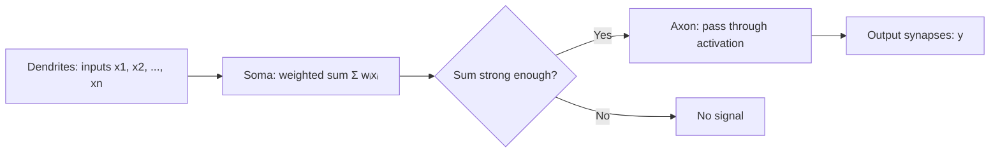

# Day 01 — Theory: Introduction to Machine Learning

**Module:** Module 1: Foundations

## 1. Big Picture: AI vs ML vs Deep Learning

Think of **AI** as the whole umbrella: any machine that acts "smart".
**Machine Learning (ML)** is one part of AI: the machine learns from examples instead of being given strict rules.
**Deep Learning (DL)** is one part of ML: it uses many layers of "artificial neurons" to learn very complex patterns.

- **AI** → making machines behave intelligently.
- **ML** → learning patterns from data.
- **DL** → ML with neural networks (great for images, speech, text).

Real-world examples:

- AI: a robot that plans a route.
- ML: spam email filter.
- DL: face unlock on your phone.

## 2. A Short History of ML

- **1940s–1950s:** First ideas of brain-like machines (McCulloch-Pitts neuron, Turing's thinking-machine test).
- **1950s–1960s:** Perceptron (early neural network) and Arthur Samuel coining "Machine Learning".
- **1970s–1980s:** AI winter; rule-based expert systems.
- **1980s–2000s:** Backpropagation revives neural networks; decision trees, SVMs, ensembles.
- **2010s–Present:** Deep learning + big data + GPUs; ImageNet, transformers, foundation models.

Takeaway: ML became practical when we had enough data and computing power.

## 3. From Biology to Code: Neurons

A **biological neuron** works in 4 steps (see the brain image):

1. **Dendrites receive inputs** (`x1, x2, ..., xn`) from other neurons.
2. **Soma (cell body) sums** the signals; if strong enough, it triggers.
3. **Axon sends the pulse** down its trunk (myelin speeds it up).
4. **Axon terminals split the signal** to the next neurons (outputs `y1...ym`).



An **artificial neuron** does the same idea in math: inputs `x1...xn`, each with a weight, sum them, then apply an activation function to decide the output.

## 4. What is Machine Learning?

**ML learns in 4 simple steps (like a neuron firing):**

1. **Collect examples** (data + correct answers).
2. **Find patterns** by studying those examples (training).
3. **Make a prediction** on brand-new data (inference).
4. **Check and improve** using feedback (error + retraining).

Flow:

```
Examples (data + answers) → learn pattern → trained model
New data → trained model → prediction → feedback
```

**ML is training algorithms on examples so they can find patterns and make predictions on new, unseen data — without us writing explicit rules.**

### Concrete Example: Laptop Purchase Prediction

Historical data:

| Age | Income | Previous Purchase | Bought Laptop |
|-----|--------|-------------------|---------------|
| 22  | 30K    | No                | No            |
| 25  | 40K    | No                | No            |
| 35  | 80K    | Yes               | Yes           |
| 40  | 90K    | Yes               | Yes           |
| 30  | 70K    | Yes               | Yes           |

Pattern found: higher income (around 70K+) with a previous purchase usually leads to buying.
New customer: Age 32, Income 75,000, Previous Purchase = Yes → **Predict: Buy**.

## 5. Types of Learning

- **Supervised Learning:** Uses labeled data (we know the answer). Example: predicting house prices or spam/not spam.
- **Unsupervised Learning:** Uses unlabeled data; finds hidden groups. Example: grouping customers by buying habits.
- **Semi-supervised Learning:** A little labeled data + lots of unlabeled data. Example: organizing large photo collections.
- **Reinforcement Learning:** Learns by trial, error, and rewards. Example: a game-playing agent or a self-driving car.

## 6. Why ML? Traditional Programming vs ML

- **Traditional programming:** Human writes rules; program applies them. Great for clear tasks (tax calculation, sorting).
- **ML:** We give data + examples; the model learns rules. Needed when rules are too complex or change often (speech, images, recommendations).

Limitations to remember:

- Needs good, enough data.
- Can be biased or make mistakes.
- Hard to explain sometimes ("black box").
- Needs monitoring as real-world data changes over time.

## Outcome

Learners can explain what ML is, name its main types, and recognize when ML is useful (and when it is not).